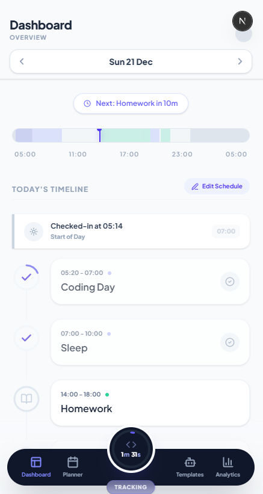

This is a [Next.js](https://nextjs.org) project bootstrapped with [`create-next-app`](https://nextjs.org/docs/app/api-reference/cli/create-next-app).

# Integrity App


**A hyper-focused execution planner designed for the disciplined.**

Integrity App is a specialized productivity tool built around the "5 AM Club" lifestyle. Unlike standard calendar apps that reset at midnight, this dashboard operates on a strict **05:00 AM to 05:00 AM** cycle, ensuring that your late-night deep work sessions remain part of the "current" day.

It combines rigorous forward planning with a persistent "Execution Mode," helping users visualize their capacity, track flow states, and maintain consistency.

---

## 🕰 The Philosophy

Standard productivity tools break the day at midnight (00:00). For high performers and night owls, this breaks the flow.

**The 5AM Rule:**
* **The Logical Day:** Starts at 05:00 AM and ends at 04:59 AM the next morning.
* **No "Tomorrow" at Midnight:** If you are working at 2 AM, you are still working on *today's* goals.
* **Plan vs. Execute:** A clear separation between "Planning Mode" (designing your future days) and "Active Mode" (executing the current day).

---

## ✨ Key Features

### 1. The Timeline Ribbon
A visual, proportional representation of your 24-hour cycle. It renders your planned sleep, morning routine, and scheduled blocks as a continuous ribbon, giving you an immediate sense of how much "day" you have left.

### 2. The Command Orb (Persistent Timer)
A global, floating timer that lives in the navigation bar.
* **Context Independent:** Navigate to view next week's schedule or review yesterday's history without stopping your current timer.
* **Refresh Proof:** Your elapsed time is safeguarded against browser refreshes or accidental closures via database timestamp syncing.

### 3. Context-Aware Planning
The task editor is smarter than a simple form.
* **Smart Gaps:** Clicking to add a task between 1:00 PM and 3:00 PM automatically suggests a 2-hour block to fill the gap perfectly.
* **Flex Capacity:** The "Flex Bucket" analyzes your remaining wakeful hours versus your committed task volume, warning you if you are overcommitted before you even start.

### 4. Time Travel & History
* **Seamless Navigation:** Jump between days instantly.
* **Ghost States:** Review past days or plan future ones without interrupting the active execution of "Today."
* **Receipts:** When a day is finished, it generates a "Completed View" summary—a receipt of your productivity.

---

## 🛠 Tech Stack

* **Frontend:** [Next.js 14](https://nextjs.org/) (App Router, React Server Components)
* **Language:** TypeScript
* **Styling:** Tailwind CSS + Lucide Icons
* **Backend / Database:** [Supabase](https://supabase.com/) (PostgreSQL)
* **State Management:** Custom React Hooks for time logic and optimistic UI updates.

---

## 🚀 Getting Started

### Prerequisites
* Node.js 18+
* A Supabase account (Free tier is fine)

### Installation

1.  **Clone the repository**
    ```bash
    git clone [https://github.com/kysing02/integrity-app.git](https://github.com/kysing02/integrity-app.git)
    cd integrity-app
    ```

2.  **Install dependencies**
    ```bash
    npm install
    # or
    yarn install
    ```

3.  **Environment Setup**
    Create a `.env.local` file in the root directory and add your Supabase credentials:
    ```env
    NEXT_PUBLIC_SUPABASE_URL=your_supabase_url
    NEXT_PUBLIC_SUPABASE_ANON_KEY=your_supabase_anon_key
    ```

4.  **Database Setup**
    Run the SQL scripts located in `src/lib/schema.sql` (or equivalent) in your Supabase SQL Editor to create the necessary `days`, `tasks`, and `timer_logs` tables.

5.  **Run the development server**
    ```bash
    npm run dev
    ```
    Open [http://localhost:3000](http://localhost:3000) with your browser.

---

## 📖 Usage Guide

1.  **Start Planning:** Navigate to a future date. Click "Start Planning" to open the canvas.
2.  **Build Your Day:** Add "Consistency" (Routine) or "Efficiency" (Deep Work) tasks. The modal will help you fit them into your timeline.
3.  **Execution:** When the day arrives (05:00 AM), the dashboard unlocks "Active Mode."
4.  **Track Flow:** Click the play button on a task. The **Command Orb** takes over, tracking your focus time globally.
5.  **Finish Strong:** Once your tasks are done, check out to generate your daily summary.

---

## 🤝 Contributing

This is a personal execution system ("Integrity App"), but ideas are welcome.
1.  Fork the Project
2.  Create your Feature Branch (`git checkout -b feature/AmazingFeature`)
3.  Commit your Changes (`git commit -m 'Add some AmazingFeature'`)
4.  Push to the Branch (`git push origin feature/AmazingFeature`)
5.  Open a Pull Request

---